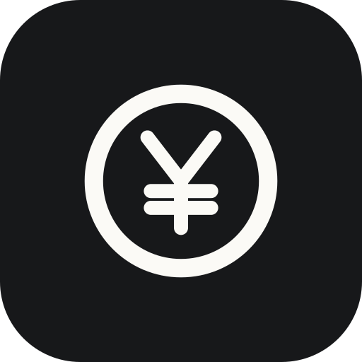

<p align="center"></p>

<h1 align="center">碎银集 · CoinDiary</h1>

<p align="center">一个纯离线的安卓记账 App，核心是「每日预算 + 结余自动滚存」</p>

不用注册、不联网、数据只存在手机里。

> **名字由来**：每天省下的一点钱，像碎银子一样一枚一枚攒起来 —— 攒着攒着就是一整笔。
> 图标就是那枚硬币：深墨底、纸白圆环、中间一个 ¥，和 App 内部的「收银小票」语言是同一套。

---

## 当前状态：V1.3 已编译通过，可直接安装

| 项目 | 结果 |
|---|---|
| 版本 | 1.3（改名「碎银集」+ 全新自适应图标） |
| 应用名 | 碎银集（桌面显示）· CoinDiary（英文名 / 仓库名） |
| 编译 | 通过（JDK 17 + Android SDK 34 + Gradle 8.9） |
| 单元测试 | 8 个用例全部通过（含小明的三天例子 + 月视图统计） |
| 产物 | `apk/CoinDiary-v1.3-debug.apk`（已签名） |
| 设计预览 | 用浏览器打开 `design-preview.html`，不装 App 也能先看界面 |
| 包名 | `com.xiaoming.dailybudget`（保持不变，避免旧数据丢失） |
| 支持版本 | Android 8.0（API 26）及以上 |

**装到手机**：把 `apk/CoinDiary-v1.3-debug.apk` 传到手机（微信文件传输 / 数据线都行），
点击安装，首次会提示「未知来源」，允许即可。
（装过旧版的话直接覆盖安装，数据不会丢。）

> 这是 debug 版：能正常日常使用，只是包体略大、不带正式发布签名。
> 以后想上应用商店再打 release 包。

---

## 一、这个 App 解决什么问题

普通记账 App 的预算是「一个月给你 900，花完拉倒」。
这个 App 的思路是「**每天给你 30，没花完的自动攒起来，花超了从攒的钱里扣**」。

效果就是：你会有动力在省钱的日子攒钱，因为攒下的额度后面能花。

---

## 二、核心算法（一句话就能讲明白）

```
总剩余预算 = 从起始日到今天，每天的有效预算之和 − 这段时间的总支出
```

拿小明的例子验算（日预算 30 元）：

| 日期 | 当天消费 | 累计支出 | 累计预算 | 总剩余预算 |
|---|---|---|---|---|
| 第 1 天 | 20 | 20 | 30 | **10** |
| 第 2 天 | 25 | 45 | 60 | **15** |
| 第 3 天 | 35 | 80 | 90 | **10** |

第 3 天超支了 5 元，从池子里的 15 元扣掉，剩 10 元 —— 和手算一致。

这个逻辑写在 `app/src/main/java/com/xiaoming/dailybudget/logic/BudgetCalculator.kt`，
并且有单元测试把上面这个例子固化了（`BudgetCalculatorTest.kt`），改代码时能自动发现算错。

---

## 三、预算的三种设置方式（优先级从高到低）

| 优先级 | 类型 | 说明 | 例子 |
|---|---|---|---|
| 1（最高） | **单独某一天** | 只影响那一天 | 朋友生日聚餐，那天设 100 元 |
| 2 | **按星期几** | 每周的这一天都用这个金额 | 周六周日设 50 元，工作日 30 元 |
| 3（兜底） | **默认日预算** | 每天都按这个金额 | 统一 30 元 |

**改预算时从「改的那天」起生效，过去的日期不受影响。**
实现方式是只追加一条带生效日期的规则，不修改历史数据。

---

## 四、界面设计（V1.3）

视觉主张是「**收银小票 / 存根**」—— 记账的本质就是一张张小票，所以界面不装可爱，
也不套常见的绿色 Material 卡片，而是用票据的语言：

| 要素 | 做法 | 为什么 |
|---|---|---|
| 底色 | 纸面 `#F2F1EC` + 票据白 `#FBFAF6` | 长时间看不刺眼，两层就够，不做渐变 |
| 描边 | 1dp 细线 + 虚线分割 | 替代阴影，像小票的撕口和分栏 |
| 圆角 | 6dp，近乎直角 | 票据不该圆润 |
| 数字 | 全部等宽字体 | 金额竖排自动对齐，不靠手工补空格 |
| 红色 | 只出现在「超支」和「删除」 | 一处用力，其他安静 |
| 进度 | 24 段刻度尺 | 比平滑进度条更像仪表，扫一眼就知道花了多少 |

### 图标（V1.3 重做）

一枚硬币：深墨底、纸白圆环、中央一个 ¥。用的是 Android 自适应图标（Adaptive Icon），
系统会按各家桌面的形状自己裁切，圆形/方形/水滴屏都不会被切坏。

设计过程中做过三个版本对比（带绿底线、绿 ¥、全白），最后选了**全白** ——
因为缩到 40dp 时，绿色装饰会糊成一道灰痕，而纯黑白反而最清晰。

- 前景：`app/src/main/res/drawable/ic_launcher_foreground.xml`
- 底色：`app/src/main/res/values/colors.xml` 里的 `icon_background`
- 仓库头像/宣传用：`docs/icon.svg`（512px 矢量，可直接上传到 GitHub 做头像）

### 四个页面

1. **今天**
   - 大字「今天还能花 ¥xx」（超支时变红，并在右上角盖一枚倾斜的「超支」印章）
   - 刻度尺显示今天花了预算的多少
   - 今日预算 / 今日已花 / 之前结余 三栏
   - 存钱罐卡：截至昨天的结余 + 近 7 天柱状图，一眼看出滚存走势
   - 今日账单列表（小票条目式，右侧细小 × 删除）
   - 右下角「记一笔」

2. **日历**（V1.2 新增）
   - 左右箭头切换月份，非本月时出现「回到本月」
   - 顶部三栏：本月预算 / 本月已花 / 本月结余
   - 7 列日历网格，格子里直接写当天花了多少：
     - 有结余 → 苔绿；超支 → 印章红
     - 格子底部的细刻度 = 这天花了当天预算的百分之几
     - 没花钱的日子只有日期，保持安静
     - 今天 1dp 描边；点中某天整块反白（墨底纸字）
   - 点任意一天，下面立刻展开当天明细：预算 / 已花 / 结余 + 逐笔记录（可删除）
   - 「＋ 在这天记一笔」直接补记那天的账
   - 底部「本月花在哪儿」：分类排行 + 占比条

3. **明细**
   - 一本流水账：每天一条抬头（日期 / 预算 / 结余），下面是当天的条目
   - 结余正数苔绿、负数印章红

4. **预算**
   - 默认日预算（大字显示，右侧「修改」）
   - 周一至周日七行，没设的显示「跟随默认」
   - 单独设置某一天，可删除
   - 末尾一句话说明优先级：单独某天 ＞ 周几 ＞ 默认日预算

「记一笔」支持：金额、日期（可补记往日）、分类（餐饮/交通/购物/娱乐/居家/医疗/其他）、备注。

> 想看设计长什么样又不想装 App：用浏览器打开 `design-preview.html`，
> 里面是四屏的完整视觉稿 + 设计 token 说明。

---

## 五、怎么装到手机上

### 方案 A：直接用已编译好的 APK（最快）

`apk/CoinDiary-v1.3-debug.apk` 传到手机安装即可，不用装任何软件。

### 方案 B：GitHub 云端自动打包

1. 在手机上或电脑上，去 GitHub 新建一个空仓库（Private 也可以）
2. 把 `DailyBudgetApp` 文件夹里的所有文件上传上去（网页拖拽即可）
3. 打开仓库的 **Actions** 标签页 —— 会自动开始编译
4. 等 3~5 分钟，点进绿色的那一次运行，页面底部 **Artifacts** 下载 `DailyBudget-apk`
5. 解压得到 `app-debug.apk`，传到手机上安装

流水线文件在 `.github/workflows/build-apk.yml`，它会先跑单元测试再打包，
测试挂了就不会出 APK，等于帮你把关。

### 方案 C：用 Android Studio 打开

1. 下载安装 [Android Studio](https://developer.android.com/studio)（约 3GB）
2. **先把 `DailyBudgetApp` 整个文件夹复制到纯英文路径**，例如 `D:\DailyBudgetApp`
   （原因见下方「中文路径的坑」，这一步很容易被忽略）
3. `File → Open` 选择该文件夹
4. 等它自动下载 Gradle 8.9 和依赖（第一次比较慢，需要能访问 Google 的仓库）
5. 手机开「开发者选项 → USB 调试」，插上线，点绿色三角运行

> 国内网络下方案 C 可能卡在下载依赖。如果卡住，在 `settings.gradle.kts` 的
> `repositories` 里把 `google()` 换成阿里云镜像
> `maven { url = uri("https://maven.aliyun.com/repository/google") }`，
> `mavenCentral()` 换成 `maven { url = uri("https://maven.aliyun.com/repository/public") }`。

### 中文路径的坑（重要）

Windows 上 Android 构建工具**不接受含中文的项目路径**，会直接报
`Your project path contains non-ASCII characters`。

本项目已在 `gradle.properties` 里加了 `android.overridePathCheck=true` 允许中文路径，
编译能过，但**单元测试会在中文路径下莫名报 `ClassNotFoundException`**（已实测确认）。

所以：只想打包 → 命令 `gradle assembleDebug` 在当前路径也能跑；
要跑测试或用 Android Studio → 请把项目放到纯英文路径。
GitHub Actions 用的是 Linux，完全没有这个问题。

---

## 六、代码结构（按阅读顺序看）

```
DailyBudgetApp/
├── app/src/main/java/com/xiaoming/dailybudget/
│   ├── logic/BudgetCalculator.kt      ★ 核心算法，先看这个
│   ├── data/
│   │   ├── TransactionEntity.kt        支出记录表
│   │   ├── BudgetRuleEntity.kt         预算规则表（三种类型）
│   │   ├── Daos.kt                     数据库读写
│   │   └── AppDatabase.kt              数据库初始化
│   ├── AppViewModel.kt                 把数据库和界面连起来
│   ├── MainActivity.kt                 底部四个页签的框架
│   └── ui/
│       ├── HomeScreen.kt               首页
│       ├── CalendarScreen.kt           月视图日历（V1.2 新增）
│       ├── DetailScreen.kt             明细页
│       ├── BudgetScreen.kt             预算设置页
│       ├── AddTransactionDialog.kt     记一笔弹窗
│       ├── Components.kt               公共小组件
│       └── theme/Theme.kt              配色
├── app/src/test/java/.../BudgetCalculatorTest.kt   ★ 算法测试
└── .github/workflows/build-apk.yml     云端打包流水线
```

技术栈：Kotlin + Jetpack Compose（界面）+ Room（本地数据库）+ MVVM。
没有用第三方依赖注入框架，尽量少的概念，方便读懂。

---

## 七、金额为什么用「分」

30.50 元存成 `3050`（分）。因为 `Double` 存小数会丢精度，
算钱必须用整数，否则账目会对不上。界面上显示时再除以 100。

---

## 八、当前版本没做的（V1 范围外）

- 收入记账（只记支出，因为滚存只关心花出去的钱）
- 修改已有记录（现在只能删了重记）
- 数据导出 / 备份 / 云同步
- 分类自定义
- 每日提醒

需要哪个可以后面加，数据表结构已经留好了扩展空间。
